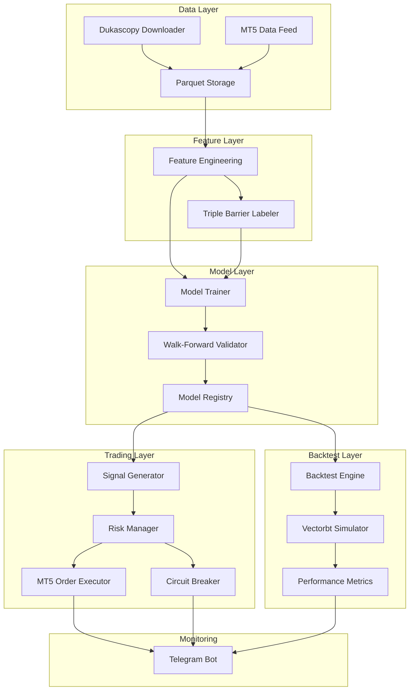
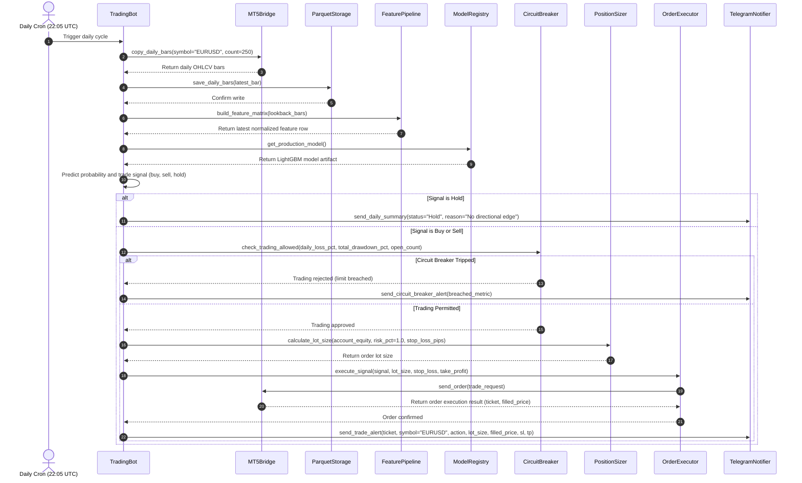

# System Architecture

DareFX operates as a sequential trading pipeline: data ingestion downloads and stores EUR/USD price bars, feature engineering calculates technical indicators, the labeling engine assigns triple barrier targets, supervised models predict trade direction, the signal generator converts predictions into buy, sell, or hold actions, the risk manager validates account thresholds and sizes positions, the execution engine places orders via MetaTrader 5, and the monitoring subsystem dispatches execution metrics and risk events to Telegram.

## Component Diagram



## Module Map

| Module Path | Responsibility | Key Classes and Functions | Dependencies |
|---|---|---|---|
| `src/darefx/data/downloader.py` | Fetches raw ticks and bars from Dukascopy HTTP endpoints and HISTDATA archives | `DukascopyDownloader`, `HistDataDownloader`, `download_ticks()`, `download_minute_bars()` | `requests`, `pandas`, `pyarrow` |
| `src/darefx/data/cleaner.py` | Filters weekend bars, flags market holidays, normalizes timezones to UTC, and flags price outliers | `DataCleaner`, `clean_daily_bars()`, `flag_outliers()`, `remove_weekend_bars()` | `pandas`, `numpy` |
| `src/darefx/data/storage.py` | Reads and writes partitioned annual Parquet files | `ParquetStorage`, `save_daily_bars()`, `load_daily_bars()`, `get_dataset_date_range()` | `pyarrow`, `pandas` |
| `src/darefx/features/indicators.py` | Computes technical indicators (RSI, MACD, Bollinger Bands, ATR, ADX, EMAs, Stochastic, OBV, VWAP-proxy) | `TechnicalFeatures`, `compute_all_indicators()`, `compute_momentum()`, `compute_trend()` | `pandas`, `pandas-ta`, `numpy` |
| `src/darefx/features/labeling.py` | Computes triple barrier labels and horizontal/vertical barrier hit times | `TripleBarrierLabeler`, `compute_daily_volatility()`, `apply_barriers()`, `get_events()` | `pandas`, `numpy` |
| `src/darefx/features/pipeline.py` | Sequences indicator calculation, rolling z-score normalization, warmup trimming, and label alignment | `FeaturePipeline`, `build_feature_matrix()`, `normalize_features()` | `pandas`, `pyarrow`, `scikit-learn` |
| `src/darefx/models/trainer.py` | Trains LightGBM and XGBoost classifiers; runs Optuna Bayesian parameter tuning | `ModelTrainer`, `train_lightgbm()`, `train_xgboost()`, `tune_hyperparameters()` | `lightgbm`, `xgboost`, `optuna`, `scikit-learn` |
| `src/darefx/models/validator.py` | Runs rolling walk-forward validation and Combinatorial Purged Cross-Validation (CPCV) with purge and embargo | `WalkForwardValidator`, `CPCVValidator`, `purge_and_embargo()`, `generate_train_test_splits()` | `scikit-learn`, `pandas`, `numpy` |
| `src/darefx/models/registry.py` | Serializes, versions, loads, and manages model artifacts and training metadata | `ModelRegistry`, `save_model()`, `load_model()`, `get_production_model()` | `pydantic`, `pathlib` |
| `src/darefx/backtest/engine.py` | Translates model predictions into discrete trading signals and constructs portfolio position targets | `BacktestEngine`, `generate_signals()`, `prepare_backtest_feed()` | `pandas`, `numpy` |
| `src/darefx/backtest/simulator.py` | Executes trade simulations using vectorbt; models spreads, slippage, and overnight swaps | `VectorbtSimulator`, `run_simulation()`, `build_portfolio()` | `vectorbt`, `pandas` |
| `src/darefx/backtest/metrics.py` | Calculates Sharpe ratio, maximum drawdown, win rate, profit factor, and generates tear-sheet plots | `PerformanceMetrics`, `calculate_metrics()`, `plot_equity_curve()`, `generate_tearsheet()` | `matplotlib`, `plotly`, `pandas`, `numpy` |
| `src/darefx/risk/sizing.py` | Calculates trade lot size using fixed fractional risk and half-Kelly position sizing | `PositionSizer`, `calculate_fixed_fractional()`, `calculate_half_kelly()`, `lots_from_risk()` | `math`, `pydantic` |
| `src/darefx/risk/circuit_breaker.py` | Monitors daily loss (5% limit), account drawdown (15% limit), and open position caps (3 maximum) | `CircuitBreaker`, `check_daily_loss()`, `check_max_drawdown()`, `can_open_position()` | `pydantic`, `datetime` |
| `src/darefx/trading/mt5_bridge.py` | Connects to MetaTrader 5 IPC terminal, queries account balance, reads rates, and submits orders | `MT5Bridge`, `initialize()`, `shutdown()`, `get_account_info()`, `copy_daily_bars()`, `send_order()` | `MetaTrader5` |
| `src/darefx/trading/executor.py` | Converts position sizing and signal targets into MT5 market order requests with SL and TP | `OrderExecutor`, `execute_signal()`, `close_position()`, `sync_positions()` | `MetaTrader5`, `pydantic` |
| `src/darefx/trading/bot.py` | Orchestrates daily scheduled loop, feature preparation, prediction, risk gate, execution, and alert pipeline | `TradingBot`, `run_daily_cycle()`, `start()`, `stop()` | `pydantic`, `rich` |
| `src/darefx/notifications/telegram.py` | Sends trade execution reports, circuit breaker alarms, and daily balance digests to Telegram | `TelegramNotifier`, `send_trade_alert()`, `send_circuit_breaker_alert()`, `send_daily_summary()` | `python-telegram-bot` |
| `src/darefx/config.py` | Loads, validates, and exposes typed environment settings for MT5, risk limits, and model paths | `Settings`, `get_settings()` | `pydantic`, `pydantic-settings`, `python-dotenv` |
| `src/darefx/cli.py` | Exposes command-line interface commands for data ingestion, feature generation, training, backtesting, and live bot runs | `cli_app`, `download()`, `train()`, `backtest()`, `run()` | `typer`, `rich` |

## Data Flow Diagram

The sequence diagram below displays the end-of-day execution cycle triggered by a daily cron schedule at 22:05 UTC (immediately following forex market rollover).



## Technology Stack

| Component | Choice | Version | Why |
|---|---|---|---|
| Runtime | Python | >=3.12 | Language runtime offering enhanced dictionary performance, improved error tracebacks, and type parameter syntax |
| Data manipulation | pandas | >=2.2 | In-memory time-series alignment, rolling calculations, and financial tabular data operations |
| Columnar storage | pyarrow | >=17.0 | Fast read and write backend for Apache Parquet files with zero-copy data conversion |
| HTTP client | requests | >=2.32 | Downloads historical raw tick and bar files from Dukascopy and HISTDATA web endpoints |
| Technical indicators | pandas-ta | >=0.3.14b1 | Direct calculation of 130+ technical analysis indicators natively on pandas series |
| Primary ML model | lightgbm | >=4.5 | Gradient boosted decision trees optimized for speed, low memory consumption, and tabular data |
| Secondary ML model | xgboost | >=2.1 | Second gradient boosting implementation for performance benchmarking and cross-validation |
| ML utilities | scikit-learn | >=1.5 | Preprocessing scalers, classification score calculators, and train-test splitting logic |
| Hyperparameter search | optuna | >=4.0 | Tree-structured Parzen Estimator (TPE) Bayesian hyperparameter optimization engine |
| Vectorized backtester | vectorbt | >=0.26 | Vectorized backtesting framework running parameter grid sweeps across historical bars |
| Alerts and monitoring | python-telegram-bot | >=21.0 | Asynchronous Telegram Bot API wrapper for push notifications and account status queries |
| Static visualization | matplotlib | >=3.9 | Static image generation for equity curves, drawdown charts, and walk-forward tear sheets |
| Interactive visualization | plotly | >=5.24 | Web-ready interactive candlestick and equity inspection charts |
| Type validation | pydantic | >=2.9 | High-speed data parsing and validation for trade requests and pipeline schemas |
| Configuration | pydantic-settings | >=2.5 | Typed settings loading from environment variables and `.env` files with validation |
| Environment loader | python-dotenv | >=1.0 | Reads key-value pairs from `.env` and exports them to process environment variables |
| Command-line interface | typer | >=0.12 | CLI builder based on Python type hints |
| Terminal formatting | rich | >=13.8 | Formatted terminal output, progress bars, and execution tables for CLI commands |
| Broker IPC bridge | MetaTrader5 | >=5.0.4424 | Official IPC connector for communication with local MetaTrader 5 terminal instances |
| Test runner | pytest | >=8.3 | Automated testing framework for unit, integration, and property tests |
| Test coverage | pytest-cov | >=5.0 | Statement and branch coverage analysis plugin for pytest |
| Linter and formatter | ruff | >=0.6 | Rust-based linter and formatter enforcing PEP 8 and import sorting standards |
| Static type checker | pyright | >=1.1 | Strict static type verification tool for Python |
| Interactive kernel | ipykernel | >=6.29 | Python execution kernel for Jupyter notebooks |
| Interactive notebooks | jupyter | >=1.1 | Notebook environment for exploratory data analysis and visual feature inspection |

## Design Decisions and Tradeoffs

1. **LightGBM over LSTM**
   - **Decision**: LightGBM is the primary classification model for trade direction.
   - **Alternatives considered**: LSTM (Long Short-Term Memory recurrent neural networks), Transformer-based time-series models.
   - **Why this choice**: Financial tabular data exhibits weak signal-to-noise ratios. Gradient boosted decision trees consistently outperform deep recurrent neural networks on structured tabular datasets across empirical benchmarks. LightGBM trains in seconds on CPU, provides feature importance rankings via split and gain metrics, and prevents the overfitting common to overparameterized neural networks on small daily sample sizes (~5,000 daily bars across 20 years).

2. **Triple Barrier Labeling over Binary Fixed-Horizon Labels**
   - **Decision**: Labels reflect the outcome of upper, lower, and vertical barriers.
   - **Alternatives considered**: Binary direction labels ($Close_{t+h} > Close_t$), continuous forward returns.
   - **Why this choice**: Binary fixed-horizon labels ignore intraday path dependency, drawdowns, and real-world stop-loss and take-profit mechanics. Triple barrier labeling assigns $+1$ only if the take-profit barrier triggers before the stop-loss barrier or the time horizon expires. This mirrors real trading orders where positions exit upon touching defined loss thresholds.

3. **Walk-Forward Validation over K-Fold Cross-Validation**
   - **Decision**: Models undergo walk-forward rolling window validation with purge and embargo periods.
   - **Alternatives considered**: Standard k-fold cross-validation, stratified k-fold cross-validation.
   - **Why this choice**: Financial market prices contain temporal structure and autocorrelation. Shuffling samples in standard k-fold cross-validation leaks future information into past training folds. Walk-forward testing preserves the temporal order: models train only on past observations and evaluate strictly on forward out-of-sample data.

4. **Apache Parquet over SQLite**
   - **Decision**: Historical market data and engineered features reside in partitioned Parquet files via pyarrow.
   - **Alternatives considered**: SQLite, PostgreSQL, raw CSV files.
   - **Why this choice**: The workload consists of bulk column reads over millions of rows for indicator calculations. Parquet stores data column-by-column, uses Snappy compression to reduce disk usage by 75% compared to CSV, loads directly into pandas memory via pyarrow zero-copy reads, and eliminates SQL database server management.

5. **vectorbt over Backtrader**
   - **Decision**: vectorbt drives backtest parameter optimization and simulation.
   - **Alternatives considered**: Backtrader, Zipline, custom event-driven loops.
   - **Why this choice**: Event-driven backtesting loops in Python iterate row-by-row, requiring minutes to hours for parameter sweeps. vectorbt represents price bars, positions, and trades as multi-dimensional NumPy arrays and Numba-compiled routines. This vectorization completes multi-year backtests across thousands of parameter combinations in seconds.

6. **Telegram Bot over Web Dashboard**
   - **Decision**: A Telegram bot provides notifications, status queries, and manual emergency kill switches.
   - **Alternatives considered**: Full-stack web dashboard (FastAPI + React), Grafana + Prometheus stack.
   - **Why this choice**: DareFX runs as a personal auto-trading bot for a single user. Telegram offers push notifications to mobile phones, bidirectional command input, and end-to-end security without hosting public web servers, configuring reverse proxies, or paying cloud infrastructure fees.

## Directory Structure

```
gallant-hawking/
├── .env.example                                  # Template for environment configuration variables
├── .gitignore                                    # Git exclusion rules for data, models, and caches
├── pyproject.toml                                # Project metadata, dependencies, and tool settings
├── README.md                                     # Project overview, goals, and setup instructions
├── data/
│   ├── raw/                                      # Downloaded raw tick files and 1-minute CSV/ZIP archives
│   ├── processed/                                # Cleaned and resampled annual Parquet daily bar files
│   └── models/                                   # Serialized model weights, configs, and training metadata
├── docs/
│   ├── ARCHITECTURE.md                           # System design, module map, data flow, and tech stack
│   ├── DATA-PIPELINE.md                          # Data acquisition, cleaning, indicators, and labeling
│   ├── FOREX-101.md                              # Guide on currency pairs, pips, margin requirements, and swaps
│   ├── PRD.md                                    # Product requirements document
│   ├── RISK-MANAGEMENT.md                        # Position sizing, Kelly criterion, and circuit breaker rules
│   ├── ROADMAP.md                                # Six-month execution roadmap by development phase
│   ├── SRS.md                                    # Software requirements specification
│   └── TODO.md                                   # Task checklist covering all deliverables
├── notebooks/
│   ├── 01_data_exploration.ipynb                 # Dukascopy and HISTDATA inspection and distribution checks
│   ├── 02_feature_analysis.ipynb                 # Indicator correlation, feature importance, and stationarity
│   ├── 03_labeling_experiments.ipynb             # Triple barrier parameter testing and class balance checks
│   ├── 04_model_prototypes.ipynb                 # Baseline LightGBM/XGBoost training runs
│   └── 05_backtest_evaluation.ipynb              # Vectorbt simulation and tear-sheet inspection
├── src/
│   └── darefx/
│       ├── __init__.py                           # DareFX package root
│       ├── cli.py                                # Typer CLI application entry point
│       ├── config.py                             # Pydantic BaseSettings configuration loader
│       ├── backtest/
│       │   ├── __init__.py                       # Backtest package exports
│       │   ├── engine.py                         # Signal generation and backtest data prep
│       │   ├── metrics.py                        # Sharpe, Sortino, Calmar, and drawdown calculations
│       │   └── simulator.py                      # Vectorbt trade execution and portfolio modeling
│       ├── data/
│       │   ├── __init__.py                       # Data package exports
│       │   ├── cleaner.py                        # Weekend filtering, holiday tags, and outlier checks
│       │   ├── downloader.py                     # Dukascopy HTTP downloader and HISTDATA scraper
│       │   └── storage.py                        # Annual Parquet read and write operations
│       ├── features/
│       │   ├── __init__.py                       # Features package exports
│       │   ├── indicators.py                     # Technical indicator calculations via pandas-ta
│       │   ├── labeling.py                       # Triple barrier method implementation
│       │   └── pipeline.py                       # Rolling normalization and feature matrix assembler
│       ├── models/
│       │   ├── __init__.py                       # Models package exports
│       │   ├── registry.py                       # Model artifact loading and version persistence
│       │   ├── trainer.py                        # LightGBM and XGBoost training with Optuna
│       │   └── validator.py                      # Walk-forward and CPCV evaluation routines
│       ├── notifications/
│       │   ├── __init__.py                       # Notifications package exports
│       │   └── telegram.py                       # Telegram bot client and message templates
│       ├── risk/
│       │   ├── __init__.py                       # Risk package exports
│       │   ├── circuit_breaker.py                # Drawdown and open position limits
│       │   └── sizing.py                         # Fixed fractional and half-Kelly position calculation
│       └── trading/
│           ├── __init__.py                       # Trading package exports
│           ├── bot.py                            # Daily trading orchestration cycle
│           ├── executor.py                       # Order formatting, validation, and submission
│           └── mt5_bridge.py                     # MetaTrader 5 Python API connector
└── tests/
    ├── __init__.py                               # Test package root
    ├── test_backtest.py                          # Unit tests for vectorbt simulator and metrics
    ├── test_cleaner.py                           # Tests for weekend gap removal and outlier flags
    ├── test_downloader.py                        # Mock tests for data download routines
    ├── test_features.py                          # Tests for technical indicators and rolling normalization
    ├── test_labeling.py                          # Tests for triple barrier label assignments
    ├── test_models.py                            # Tests for LightGBM training and registry saving
    ├── test_risk.py                              # Tests for position sizing math and circuit breaker limits
    └── test_trading.py                           # Tests for order execution logic and MT5 bridge
```
