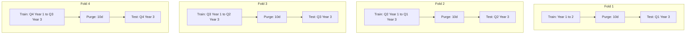

# Data Pipeline Specification

The DareFX data pipeline ingests, cleans, stores, and transforms EUR/USD price records into engineered features and triple barrier labels for machine learning model training and backtesting.

## Data Sources

The system ingests market data from three distinct providers depending on the development and deployment phase.

| Source | Timeframe | History Range | Protocol | Authentication | Target Phase |
|---|---|---|---|---|---|
| Dukascopy | Tick-level | 2003 to present | HTTP GET (bi5 binary format) | None (Public) | Historical backtesting and model training |
| HISTDATA.com | 1-minute (M1) bars | 2000 to present | HTTP GET (ZIP/ASCII CSV) | None (Public) | Cross-validation and data verification |
| MetaTrader 5 (Valetax) | 1-day (D1) bars | 2020 to present | Python IPC (`MetaTrader5` package) | Broker login credentials | Paper trading and live execution |

### Dukascopy Ingestion Mechanism

Dukascopy provides raw tick archives organized by currency pair, year, month, day, and hour.

- **URL Pattern**:
  `https://datafeed.dukascopy.com/datafeed/EURUSD/{YYYY}/{MM_ZERO_INDEXED}/{DD}/{HH}h_ticks.bi5`
  *(Note: Month index is zero-based: January = `00`, December = `11`)*

- **Binary Decompression**:
  Each `.bi5` file contains an LZMA-compressed binary byte stream. Decompressing the stream yields continuous 20-byte structs:
  - Field 1 (4 bytes, uint32, big-endian): Milliseconds elapsed since the start of the hour.
  - Field 2 (4 bytes, uint32, big-endian): Ask price expressed in integer points. EUR/USD divides by $100,000$ (`1e-5`).
  - Field 3 (4 bytes, uint32, big-endian): Bid price expressed in integer points. EUR/USD divides by $100,000$ (`1e-5`).
  - Field 4 (4 bytes, float32, big-endian): Ask volume.
  - Field 5 (4 bytes, float32, big-endian): Bid volume.

- **Extraction Script Workflow**:
  `src/darefx/data/downloader.py` issues HTTP requests for each hour of each trading day, decompresses the LZMA payload, decodes the binary structs into NumPy structured arrays, calculates timestamps as `hour_start_timestamp + timedelta(milliseconds=offset)`, and appends the records into daily tick arrays.

### HISTDATA.com Ingestion Mechanism

HISTDATA.com provides 1-minute aggregated bid bars packaged in monthly ZIP archives.

- **URL Pattern**:
  `https://www.histdata.com/download-free-forex-historical-data/?/ascii/1-minute-bar-quotes/EURUSD/{YYYY}/{MM}`

- **Archive Format**:
  Each downloaded archive contains a semicolon-separated text file named `DAT_ASCII_EURUSD_M1_{YYYYMM}.csv`. Lines follow the format:
  `YYYYMMDD HHMMSS;OPEN;HIGH;LOW;CLOSE;VOLUME`

- **Parsing Pipeline**:
  `src/darefx/data/downloader.py` downloads the monthly archive, extracts the CSV file in memory, parses the custom timestamp string into UTC datetime, and loads the quotes into pandas DataFrames.

### MetaTrader 5 Ingestion Mechanism

Live and demo trading runs against the Valetax broker via the official `MetaTrader5` Python library.

- **API Method**:
  `MetaTrader5.copy_rates_range(symbol, timeframe, date_from, date_to)` or `MetaTrader5.copy_rates_from_pos(symbol, timeframe, start_pos, count)`.

- **Execution Cadence**:
  The trading daemon wakes daily at 22:05 UTC (immediately following the 22:00 UTC New York daily forex rollover) and requests the completed daily bar:
  ```python
  import MetaTrader5 as mt5

  rates = mt5.copy_rates_from_pos("EURUSD", mt5.TIMEFRAME_D1, 1, 250)
  ```
  The returned NumPy structured array contains `time`, `open`, `high`, `low`, `close`, `tick_volume`, `spread`, and `real_volume`.

## Raw Data Schema

### Tick Data Schema

| Field Name | Storage Type | Units / Format | Description |
|---|---|---|---|
| `timestamp` | `datetime64[ns, UTC]` | ISO 8601 UTC | Exact trade quote arrival time |
| `bid` | `float64` | Price quote (5 decimal places) | Price offered by buyers |
| `ask` | `float64` | Price quote (5 decimal places) | Price requested by sellers |
| `bid_volume` | `float64` | Fractional lots | Liquidity depth on bid side |
| `ask_volume` | `float64` | Fractional lots | Liquidity depth on ask side |

### 1-Minute Bar Schema

| Field Name | Storage Type | Units / Format | Description |
|---|---|---|---|
| `timestamp` | `datetime64[ns, UTC]` | Minute boundary (HH:MM:00 UTC) | Start of 1-minute period |
| `open` | `float64` | Price quote (5 decimal places) | First traded price in minute |
| `high` | `float64` | Price quote (5 decimal places) | Highest traded price in minute |
| `low` | `float64` | Price quote (5 decimal places) | Lowest traded price in minute |
| `close` | `float64` | Price quote (5 decimal places) | Last traded price in minute |
| `volume` | `float64` | Number of ticks / contracts | Aggregated bar tick count |

### Daily Aggregation Rules

The pipeline converts tick records and 1-minute bars into daily bars spanning 00:00:00 UTC to 23:59:59.999999 UTC:

- `open`: First recorded price within the UTC trading day.
- `high`: Maximum price recorded within the UTC trading day.
- `low`: Minimum price recorded within the UTC trading day.
- `close`: Last recorded price within the UTC trading day.
- `volume`: Total sum of all tick volumes recorded within the UTC trading day.
- `timestamp`: UTC date normalized to `YYYY-MM-DD 00:00:00`.

## Data Cleaning

### Weekend Gaps

Forex trading closes Friday at approximately 22:00 UTC and resumes Sunday at 22:00 UTC.

- **Rule**:
  1. Drop all bars generated on Saturday.
  2. Drop Sunday bars recorded between 00:00:00 UTC and 21:59:59 UTC.
  3. Sunday bars between 22:00:00 UTC and 23:59:59 UTC aggregate into Monday trading session bars to match New York closing convention.

### Holiday Handling

Major global holidays (Christmas Day December 25, New Year's Day January 1, Good Friday) experience severe liquidity drops and early broker market closures.

- **Rule**:
  1. Match dates against a calendar of foreign exchange market holidays.
  2. Assign boolean column `is_holiday = True` to affected rows.
  3. Keep holiday rows in the continuous time series table, but exclude them from model training splits and trade signal generation.

### Timezone Normalization

Broker feeds frequently register server time in Eastern European Time (EET / EEST, UTC+2 or UTC+3).

- **Rule**:
  1. Read broker server timezone offset metadata.
  2. Subtract broker timezone offset to convert all timestamps to UTC.
  3. Localize all DataFrame indices strictly to `UTC` (`tz_localize('UTC')`).

### Outlier Detection

Data glitches, broker connection drops, and bad quotes create artificial price spikes.

- **Rule**:
  1. Compute daily log returns: $r_t = \ln(Close_t / Close_{t-1})$.
  2. Calculate 20-day rolling mean $\mu_{20}$ and standard deviation $\sigma_{20}$.
  3. Flag any bar where $|r_t - \mu_{20}| > 5 \cdot \sigma_{20}$ as an outlier with `is_outlier = True`.
  4. Write outlier events to `logs/data_anomalies.log`.
  5. Retain extreme price events that match verified historical market volatility (such as the January 15, 2015 Swiss National Bank EUR/CHF peg removal). Do not automatically discard rows without inspection.

### Missing Data Handling

- **Single-Day Gap (1 bar missing)**:
  Forward-fill the missing bar: set `close`, `open`, `high`, and `low` to the previous bar's `close`. Set `volume` to `0.0`.
- **Multi-Day Gap (>1 bar missing)**:
  Raise a `DataIntegrityError` in `src/darefx/data/cleaner.py`. Pause execution and dispatch a critical notification to Telegram requesting manual inspection of raw source files.

## Storage

Data resides on local disk in Apache Parquet format using the PyArrow engine.

- **Root Directory**: `data/processed/`
- **File Partitioning**: Partitioned by calendar year:
  - `data/processed/eurusd_daily_2020.parquet`
  - `data/processed/eurusd_daily_2021.parquet`
  - `data/processed/eurusd_daily_2022.parquet`
  - `data/processed/eurusd_daily_2023.parquet`
  - `data/processed/eurusd_daily_2024.parquet`
- **Compression**: `snappy` compression codec.
- **Table Schema**:

| Column Name | Arrow Data Type | Nullable | Description |
|---|---|---|---|
| `timestamp` | `timestamp('ns', tz='UTC')` | No | Daily bar start timestamp |
| `open` | `float64` | No | Session open price |
| `high` | `float64` | No | Session high price |
| `low` | `float64` | No | Session low price |
| `close` | `float64` | No | Session close price |
| `volume` | `float64` | No | Session aggregate volume |

## Feature Engineering Pipeline

The feature pipeline ingests daily OHLCV bars and calculates 18 technical indicators and calendar variables.

### Indicators and Parameters

| Indicator | Parameter Configuration | Formula / Definition | Output Column |
|---|---|---|---|
| RSI | Length = 14 | Relative Strength Index tracking momentum speed and magnitude | `rsi_14` |
| MACD | Fast = 12, Slow = 26, Signal = 9 | Moving average convergence divergence line, signal line, histogram | `macd_12_26_9`, `macd_signal`, `macd_hist` |
| Bollinger Bands | Length = 20, Multiplier = 2.0 | Upper band, lower band, middle band, bandwidth, and %B oscillator | `bb_upper`, `bb_lower`, `bb_bandwidth`, `bb_pct_b` |
| ATR | Length = 14 | Average True Range measuring price volatility in absolute points | `atr_14` |
| ADX | Length = 14 | Average Directional Index measuring trend strength (0 to 100) | `adx_14` |
| EMA 9 | Length = 9 | Short-term trend exponential moving average | `ema_9` |
| EMA 21 | Length = 21 | Medium-term trend exponential moving average | `ema_21` |
| EMA 50 | Length = 50 | Intermediate trend exponential moving average | `ema_50` |
| EMA 200 | Length = 200 | Long-term macro regime exponential moving average | `ema_200` |
| Stochastic | %K = 14, %D = 3, Smooth = 3 | Oscillator comparing close price to high-low range over 14 bars | `stoch_k`, `stoch_d` |
| OBV | Cumulative | On-Balance Volume tracking volume pressure alongside price moves | `obv` |
| VWAP-Proxy | Window = 20 days | Rolling volume-weighted typical price: $\frac{\sum (P_{typ} \cdot V)}{\sum V}$ where $P_{typ} = \frac{H+L+C}{3}$ | `vwap_proxy_20` |
| Daily Return | Lag = 1 bar | Simple percentage return: $(Close_t - Close_{t-1}) / Close_{t-1}$ | `daily_return` |
| Log Return | Lag = 1 bar | Continuously compounded return: $\ln(Close_t / Close_{t-1})$ | `log_return` |
| Rolling Volatility | Window = 20 days | Standard deviation of daily log returns over past 20 bars | `rolling_vol_20` |
| Rolling Sharpe | Window = 60 days | Annualized proxy Sharpe ratio: $\frac{\text{mean}(r_{60})}{\text{std}(r_{60})} \cdot \sqrt{252}$ | `rolling_sharpe_60` |
| Day of Week | Cyclical / Categorical | Integer trading day: 0 = Monday, 1 = Tuesday, 2 = Wednesday, 3 = Thursday, 4 = Friday | `day_of_week` |
| Month | Cyclical / Categorical | Calendar month integer: 1 = January, 12 = December | `month` |

### Normalization and Leakage Prevention

To prevent look-ahead bias, feature scaling relies solely on historical statistics available at prediction time:

- **Rolling Z-Score Normalization**:
  For price distance features and unbound oscillators, the pipeline calculates rolling z-scores over a historical window of $W = 60$ trading days:
  $$z_t = \frac{x_t - \mu_{t-1, W}}{\sigma_{t-1, W}}$$
  where $\mu_{t-1, W}$ is the rolling mean and $\sigma_{t-1, W}$ is the rolling standard deviation computed from bar $t-W$ through bar $t-1$. Observation $x_t$ is never included in its own scaling calculation.

- **Warmup Trimming**:
  The longest lookback indicator in the pipeline is the 200-period EMA (`ema_200`). The pipeline drops the first 200 trading rows from the final feature dataset to eliminate transient NaN values.

- **Output Format**:
  Engineered features save to `data/processed/eurusd_features.parquet`, indexed by timestamp.

## Triple Barrier Labeling

DareFX uses the Triple Barrier Method from Marcos López de Prado (*Advances in Financial Machine Learning*, Chapter 3) to generate dynamic, risk-aware target labels.

### Barrier Definitions

For each entry bar $t$ at price $P_t$, three barriers define trade resolution:

1. **Upper Barrier (Take-Profit)**:
   $$P_{\text{upper}} = P_t \times (1 + \text{width} \times \sigma_t)$$
2. **Lower Barrier (Stop-Loss)**:
   $$P_{\text{lower}} = P_t \times (1 - \text{width} \times \sigma_t)$$
3. **Vertical Barrier (Time Expiry)**:
   $$T_{\text{vertical}} = t + \text{max\_holding\_period}$$

### Parameters

- `upper_width`: 2.0 (horizontal upper barrier multiplier)
- `lower_width`: 2.0 (horizontal lower barrier multiplier)
- `max_holding_period`: 10 trading days (vertical barrier horizon)
- `volatility_lookback`: 20 trading days (rolling daily return standard deviation $\sigma_t$)

### Target Classes

| Label Value | Condition | Trading Interpretation |
|---|---|---|
| `+1` | Price crosses $P_{\text{upper}}$ before $P_{\text{lower}}$ and before $T_{\text{vertical}}$ | Long trade reaches take-profit target |
| `-1` | Price crosses $P_{\text{lower}}$ before $P_{\text{upper}}$ and before $T_{\text{vertical}}$ | Short trade reaches take-profit target / Long stops out |
| `0` | Price touches neither horizontal barrier before $T_{\text{vertical}}$ expires | Stagnant price action (Hold / No trade) |

### Barrier Visual Representation

```
Price
  ^
  |                     [ Upper Barrier: Take Profit (+1) ]
  |---------------------------------------------------------+
  |                   / \                                   |
  |      /\          /   \  (Hits Upper Barrier -> Label +1)|
  |     /  \  /\    /     *                                 |
P0|----+----\/- \--/----------------------------------------|
  |          \  \/                                          |
  |           \                     (Expires -> Label 0)    |
  |            \              ----------------------------->|
  |             \    * (Hits Lower Barrier -> Label -1)     |
  |---------------------------------------------------------+
  |                     [ Lower Barrier: Stop Loss (-1) ]   |
  +---------------------------------------------------------+-----> Time
  t=0 (Entry)                                            t=10 (Vertical)
```

## Train/Test Split — Walk-Forward Protocol

Financial time series exhibit structural shifts and non-stationarity. DareFX uses a rolling walk-forward protocol with strict purge and embargo buffers to evaluate models without temporal leakage.

### Split Parameters

- **Train Window**: 2 rolling years (504 trading days)
- **Test Window**: 3 months (63 trading days)
- **Step Size**: 3 months (63 trading days)
- **Purge Gap**: 10 trading days before test set start. Because triple barrier labels can look ahead up to 10 trading days into the future, any training observation recorded within 10 days of the training set end overlaps with the test set. The purge removes these 10 boundary samples from the training set.
- **Embargo**: 10 trading days following the test set. When testing windows shift, an embargo of 10 days discards observations immediately following test sets to eliminate residual autoregressive correlation.

### Walk-Forward Sliding Window Diagram



## Combinatorial Purged Cross-Validation (CPCV)

While walk-forward validation produces a single continuous historical path, Combinatorial Purged Cross-Validation (CPCV) generates multiple out-of-sample backtest paths to assess strategy distribution, path dependency, and overfitting risk.

### Protocol Implementation

1. **Timeline Partitioning**:
   The complete historical dataset splits chronologically into $N = 6$ contiguous groups: $G_1, G_2, G_3, G_4, G_5, G_6$.

2. **Combinatorial Splits**:
   The validator evaluates all combinations choosing $N-1 = 5$ groups for training and $1$ group for testing, or choosing $N-k$ groups for training and $k$ groups for testing. For $N=6$ and $k=2$, this yields:
   $$\binom{6}{2} = 15 \text{ cross-validation folds}$$

3. **Purging and Embargo Rules**:
   - For every test group $G_k$, drop observations at the boundary of any preceding training group $G_{k-1}$ whose 10-day triple barrier labeling horizon intersects $G_k$.
   - Apply a 10-day embargo on the training group immediately succeeding test group $G_k$ to remove serial correlation.

4. **Out-of-Sample Path Generation**:
   Each validation fold generates out-of-sample predictions on its designated test group. Recombining non-overlapping test predictions across combinations reconstructs multiple full-length equity paths.

5. **Variance Evaluation**:
   The engine computes the Sharpe ratio, max drawdown, and profit factor across all reconstructed equity curves, establishing confidence intervals for strategy performance:
   - Target metric: $95\%$ of CPCV paths must achieve Sharpe ratio $> 1.0$.
   - Target risk: Zero paths exceed $20\%$ maximum drawdown.
