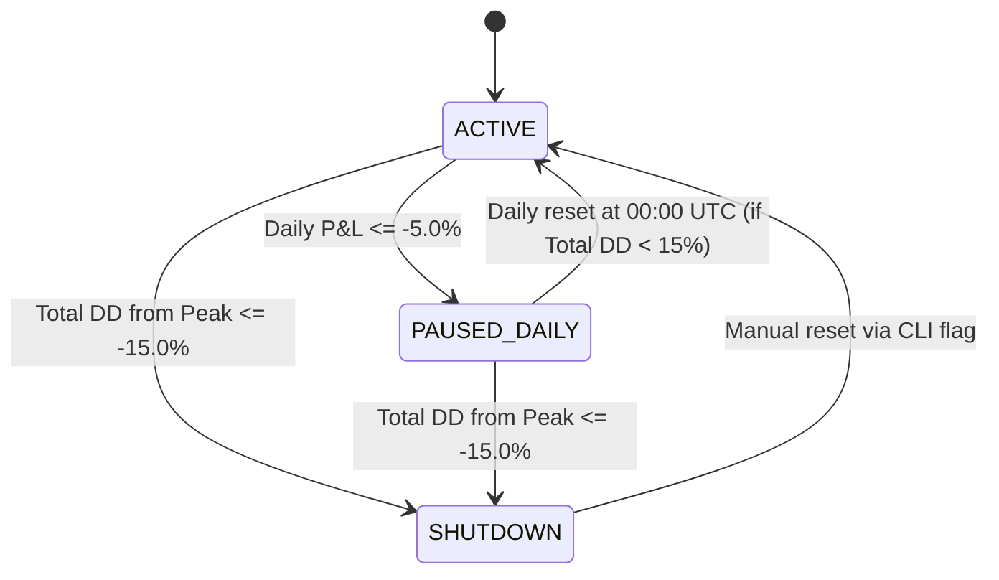

# Risk Management Engine

This document defines the quantitative risk management rules hardcoded into DareFX. Every rule in this specification executes before any signal reaches the MetaTrader 5 order bridge.

---

## 1. Why Risk Management Is the Product

In algorithmic trading, machine learning models predict direction, but risk management controls survival. 

A model with high classification accuracy will destroy an account if position sizing and drawdown controls are absent. Conversely, a model with modest accuracy produces compounding growth when paired with strict mathematical capital preservation.

### Mathematical Comparison: Model Accuracy vs. Capital Preservation

Consider two trading systems operating on a $10,000 account:

- **System A**: 70% win rate model. Sizes positions risking 25% of account balance per trade.
- **System B**: 55% win rate model. Sizes positions risking 1% of account balance per trade with a 1:1.5 reward-to-risk ratio.

#### System A (70% Accuracy, Poor Risk Controls)

In any series of trades, consecutive losses occur regularly. The probability of experiencing 3 consecutive losses:

$$P(\text{3 consecutive losses}) = (1 - 0.70)^3 = 0.30^3 = 0.027 \quad (2.7\%)$$

In 100 trades, 3 consecutive losses occur with over 90% probability. The resulting account drawdown:

$$\text{Drawdown} = 1 - (1 - 0.25)^3 = 1 - (0.75)^3 = 1 - 0.4219 = 57.81\%$$

After 3 losses, the account drops from $10,000 to $4,219. Recovering to the initial $10,000 balance requires a **137% gain**. If 4 consecutive losses occur (probability 0.81%), the account drops to $3,164, requiring a **216% gain** to break even. System A suffers ruin.

#### System B (55% Accuracy, DareFX Risk Controls)

The probability of experiencing 10 consecutive losses with a 55% win rate:

$$P(\text{10 consecutive losses}) = (1 - 0.55)^{10} = 0.45^{10} \approx 0.00034 \quad (0.034\%)$$

The account drawdown after 10 consecutive losses at 1% risk per trade:

$$\text{Drawdown} = 1 - (1 - 0.01)^{10} = 1 - (0.99)^{10} = 1 - 0.9044 = 9.56\%$$

The account drops from $10,000 to $9,044. Recovering to break even requires an **10.57% gain**, which the 55% win rate model with 1:1.5 payoff achieves within normal operating variance.

---

## 2. Position Sizing: Fixed Fractional

Fixed fractional sizing allocates risk as a fixed percentage of current account balance on every trade. As the account grows, lot sizes scale up; as the account experiences drawdown, lot sizes scale down automatically.

### The Formula

$$\text{Position Size (Lots)} = \frac{\text{Account Balance} \times \text{Risk Fraction}}{\text{Stop Loss (pips)} \times \text{Pip Value per Standard Lot}}$$

Where:
- **Account Balance**: Current account equity in USD (e.g., $10,000).
- **Risk Fraction**: Configured risk percentage per trade (default: $0.01$ for 1.0%).
- **Stop Loss (pips)**: Distance between execution price and protective stop-loss in pips ($0.0001$ price delta).
- **Pip Value per Standard Lot**: $10.00 USD for EUR/USD.

### Worked Example

- Account Balance: $10,000 USD
- Configured Risk: 1.0% ($100 USD risk)
- EUR/USD Entry Price: 1.08500
- Stop-Loss Price: 1.08000 (50-pip stop)
- Pip Value per Standard Lot: $10.00 USD

$$\text{Position Size} = \frac{10,000 \times 0.01}{50 \times 10.00} = \frac{100}{500} = 0.20 \text{ lots}$$

The bot places an order for 0.20 lots (20,000 EUR). If price hits the 50-pip stop-loss:

$$\text{Loss} = 0.20 \text{ lots} \times 50 \text{ pips} \times \$10.00/\text{lot/pip} = \$100.00 \text{ USD}$$

The realized loss equals $100.00 USD, exactly 1.00% of capital.

### Why 1% to 2% and Never More

Capital recovery is non-linear. The percentage gain required to recover from a drawdown accelerates as losses deepen:

$$\text{Required Recovery Gain} = \frac{\text{Drawdown}}{1 - \text{Drawdown}}$$

| Drawdown | Account Balance on $10,000 | Required Gain to Break Even | Consecutive 1% Losses to Hit | Consecutive 2% Losses to Hit | Consecutive 5% Losses to Hit |
|---|---|---|---|---|---|
| 5% | $9,500 | +5.3% | 5 | 3 | 1 |
| 10% | $9,000 | +11.1% | 11 | 6 | 2 |
| 15% | $8,500 | +17.6% | 16 | 8 | 3 |
| 20% | $8,000 | +25.0% | 23 | 11 | 4 |
| 30% | $7,000 | +42.9% | 36 | 18 | 7 |
| 40% | $6,000 | +66.7% | 51 | 25 | 10 |
| 50% | $5,000 | +100.0% | 69 | 34 | 14 |
| 75% | $2,500 | +300.0% | 138 | 69 | 27 |

Limiting risk to 1.0% (maximum ceiling 2.0%) ensures that even an extended 10-trade losing streak leaves the account within a 9.56% drawdown, requiring only 10.57% to recover. At 5% risk, that same 10-trade streak creates a 40.13% drawdown, requiring a 66.7% gain to break even.

---

## 3. Position Sizing: Kelly Criterion

The Kelly Criterion calculates the mathematically optimal fraction of capital to risk on a trade to maximize long-term geometric compounding rate.

### The Formula

$$f^* = \frac{p \times b - q}{b}$$

Where:
- $p$ = Probability of a winning trade (model historical win rate)
- $q = 1 - p$ = Probability of a losing trade
- $b = \frac{\text{Average Win Amount}}{\text{Average Loss Amount}}$ = Payoff ratio (win/loss ratio)

### Worked Calculation

A model evaluated over 500 walk-forward trades demonstrates:
- Win rate $p = 0.55$ ($55\%$)
- Loss rate $q = 0.45$ ($45\%$)
- Average win = $130 USD, Average loss = $100 USD $\rightarrow b = \frac{130}{100} = 1.30$

$$f^* = \frac{0.55 \times 1.30 - 0.45}{1.30} = \frac{0.715 - 0.45}{1.30} = \frac{0.265}{1.30} \approx 0.2038 \quad (20.38\%)$$

Full Kelly recommends risking 20.38% of capital per trade.

### Why DareFX Uses Half-Kelly

Full Kelly sizing produces extreme account volatility:
1. **Parameter Estimation Uncertainty**: Real-world win rates and payoff ratios are historical estimates, not fixed physical constants. If market regime shifts and win rate drops from 55% to 48%, Full Kelly overbets and causes rapid account destruction.
2. **Severe Drawdowns**: Mathematical proof shows that Full Kelly sizing has an 86% probability of experiencing a 50% peak-to-trough drawdown at some point in its lifecycle.
3. **Half-Kelly Properties**: Risking half the Kelly fraction ($f^* / 2$):
   - Cuts portfolio return variance by 50%.
   - Reduces the maximum expected drawdown by more than 50%.
   - Retains 75% of the maximum geometric growth rate.

$$\text{Half-Kelly Fraction} = \frac{f^*}{2} = \frac{0.2038}{2} = 0.1019 \quad (10.19\%)$$

### Hard Cap at Fixed Fractional Ceiling

Even Half-Kelly (10.19%) exceeds the maximum risk threshold for retail trading accounts. DareFX combines Kelly with fixed fractional sizing:

$$\text{Allocated Risk Fraction} = \min\left(\max\left(0.0, \frac{f^*}{2}\right), \text{MAX\_RISK\_PER\_TRADE\_PCT}\right)$$

Where `MAX_RISK_PER_TRADE_PCT` defaults to 1.0% ($0.01$).

- **Dynamic Edge Scaling**: When the model has strong edge ($f^* / 2 > 1.0\%$), the risk fraction caps at 1.0%.
- **Automatic Down-scaling**: If model performance decays and estimated edge shrinks, $f^*$ contracts below 1.0%, scaling down lot size. If $f^* \le 0$ (no statistical edge), sizing drops to 0.0, preventing trades entirely.

---

## 4. Circuit Breakers: System State Machine

DareFX implements an automated three-state safety state machine. Circuit breakers prevent cascading losses during abnormal market conditions or algorithm degradation.



### State Specifications

#### 1. ACTIVE State
- **Description**: Normal autonomous trading mode.
- **Operations**:
  - Ingests daily bar data at 00:00 UTC.
  - Generates model classification signals.
  - Evaluates news calendar and spread conditions.
  - Sizes positions via Kelly/fixed fractional formula.
  - Submits orders to MT5.

#### 2. PAUSED_DAILY State
- **Trigger**: Realized + unrealized P&L for the current calendar trading day drops to or below **-5.0%** of equity at day start (00:00 UTC).
  $$\text{Daily P&L \%} = \frac{\text{Current Equity} - \text{Day Start Equity}}{\text{Day Start Equity}} \times 100\% \le -5.0\%$$
- **Enforced Actions**:
  - Immediately blocks all new order creation for the remainder of the calendar trading day.
  - Retains all existing open positions. Existing positions remain protected by their hard stop-loss orders in MT5.
  - Dispatches warning alert to Telegram: `[WARNING] Daily circuit breaker triggered: P&L = -5.12%. Trading paused until 00:00 UTC.`
- **Reset Condition**: Transitions back to `ACTIVE` automatically at 00:00 UTC on the next trading day, provided total peak-to-trough drawdown remains strictly below 15.0%.

#### 3. SHUTDOWN State
- **Trigger**: Total account equity drawdown from historical High Water Mark (HWM) drops to or below **-15.0%**.
  $$\text{Drawdown \%} = \frac{\text{Current Equity} - \text{Peak Equity}}{\text{Peak Equity}} \times 100\% \le -15.0\%$$
- **Enforced Actions**:
  - Instantly issues emergency market close orders for all open positions.
  - Cancels all pending limit and stop orders in MT5.
  - Terminates the automated trading loop.
  - Dispatches high-priority alert to Telegram: `[CRITICAL] Account drawdown hit -15.0%. Bot SHUTDOWN. All positions liquidated. Manual restart required.`
- **Reset Condition**: No automated recovery. Requires manual developer investigation of model logs, validation metrics, and explicit invocation of the reset command:
  ```bash
  darefx risk reset-shutdown --confirm
  ```

---

## 5. Position Limits

DareFX enforces strict structural exposure limits prior to sending any order to the execution layer.

| Constraint | Limit | Verification Mechanism | Action on Breach |
|---|---|---|---|
| Maximum Simultaneous Open Positions | 3 | Count open tickets in MT5 account | Rejects new entry signals |
| Directional Exclusivity | 1 position per direction | Check open position direction on EUR/USD | Rejects signal if opposite or duplicate position exists |
| Maximum Account Margin Utilization | 5.0% of Balance | $\frac{\text{Total Margin Used}}{\text{Account Balance}} \le 0.05$ | Rejects order if new margin pushes total $> 5.0\%$ |

### Position Direction Isolation

DareFX never hedges (simultaneously holding long and short positions on EUR/USD). 

- If an open Long position exists and a Short signal arrives: The engine does not open a Short position. It evaluates whether the Short signal satisfies exit criteria for the Long position.
- If an open Long position exists and a new Long signal arrives: The engine permits up to the maximum position limit (3) only if scale-in criteria are met and total margin remains below 5.0%.

### Margin Utilization Math

On a $10,000 USD account with 1:100 leverage:
- Maximum allowable margin across all open positions: $10,000 \times 0.05 = \$500.00 \text{ USD}$.
- With EUR/USD at 1.0850, 1.00 standard lot requires: $\frac{100,000 \times 1.0850}{100} = \$1,085.00$ margin.
- Maximum cumulative lot size allowed across all 3 positions combined:
  $$\text{Max Cumulative Volume} = \frac{500.00}{1,085.00} \approx 0.46 \text{ lots}$$

This prevents account liquidation during extended drawdown events.

---

## 6. News Blackout

High-impact macroeconomic news releases cause liquidity providers to withdraw quotes, producing massive spread widening (from 0.5 pips up to 15+ pips) and multi-pip slippage.

### Monitored Events

DareFX monitors scheduled high-impact events for the Eurozone and United States:

1. **United States**:
   - Non-Farm Payrolls (NFP) and Unemployment Rate (first Friday of month, 13:30 UTC / 12:30 UTC DST)
   - Federal Open Market Committee (FOMC) Interest Rate Decision and Press Conference
   - Consumer Price Index (CPI) releases
2. **Eurozone**:
   - European Central Bank (ECB) Main Refinancing Rate Decision and Press Conference
   - Eurozone Consumer Price Index (HICP)

### Blackout Rules

- **Execution Freeze Window**: No new orders may be placed starting **30 minutes before** scheduled event release time through **30 minutes after** release time ($[T - 30\text{m}, T + 30\text{m}]$).
- **Existing Positions**: Positions opened prior to the blackout window remain open. The risk manager verifies that hard stop-loss and take-profit orders reside on the MT5 broker server before the blackout begins.
- **Calendar Data Source**: Downloaded daily from the ForexFactory economic calendar feed (or comparable financial calendar API) and parsed into a local schedule table.

```
Example Timeline (US CPI Release at 13:30 UTC):
13:00 UTC ── Blackout starts. New order generation blocked.
13:30 UTC ── News released. Volatility and spread spike occur.
14:00 UTC ── Blackout ends. Normal signal generation resumes.
```

---

## 7. Slippage and Spread Assumptions for Backtesting

Optimistic transaction cost assumptions produce backtests that fail in live execution. DareFX enforces conservative friction parameters in all vectorbt and event-driven backtesting runs.

### Backtest Parameter Standards

| Cost Factor | DareFX Standard Value | Retail Reality | Rationale |
|---|---|---|---|
| EUR/USD Base Spread | 1.5 pips ($0.00015$) | Raw ECN spread 0.2 - 0.8 pips | Accounts for spread widening outside London/NY overlap |
| Execution Slippage | 1.0 pip ($0.00010$) | 0.2 - 2.0 pips | Models latency and execution queue position |
| Broker Commission | $7.00 per standard lot round trip | $0.07 per 0.01 lot ($7.00/lot) | Standard Valetax ECN commission |
| Overnight Swap | Real historical swap points | Varies by interest rate cycle | Applied daily at 22:00 UTC; triple swap on Wednesday |

### Why Optimistic Assumptions Fail

Consider a daily swing strategy generating 200 trades per year with an average raw model edge of 3.0 pips per trade on 1.00 lot:

- **Raw Model Return**: $200 \text{ trades} \times 3.0 \text{ pips} \times \$10.00/\text{pip} = +\$6,000.00$
- **Naive Zero-Cost Backtest**: Reports **+$6,000.00 profit (+60% on $10,000)**.
- **True Execution Cost**:
  - Spread (1.5 pips): $200 \times 1.5 \times \$10.00 = \$3,000.00$
  - Slippage (1.0 pip): $200 \times 1.0 \times \$10.00 = \$2,000.00$
  - Commission: $200 \times \$7.00 = \$1,400.00$
  - Total Friction: $\$6,400.00$
- **Net Live Return**: $\$6,000.00 - \$6,400.00 = \mathbf{-\$400.00 \text{ loss}}$.

A strategy showing +60% in a naive backtest loses money in production.

### Stress Testing Requirement

Before model acceptance, every strategy candidate must pass a cost sensitivity stress test:
- Spread expanded to **2.5 pips**.
- Slippage expanded to **2.0 pips**.

A strategy must retain an annualized Sharpe ratio $> 0.8$ under these stress parameters. Strategies failing this test are rejected immediately.

---

## 8. Configuration Reference

All risk parameters configure through environment variables or `darefx.yaml`, validated at startup using Pydantic schemas.

| Parameter Name | Configuration Key / Env Var | Default | Min | Max | Type | Description |
|---|---|---|---|---|---|---|
| Risk Per Trade | `RISK_PER_TRADE_PCT` | `1.0` | `0.1` | `2.0` | `float` | Base fixed fractional risk as percentage of account balance |
| Max Risk Ceiling | `MAX_RISK_PER_TRADE_PCT` | `2.0` | `1.0` | `2.0` | `float` | Hard ceiling for Half-Kelly dynamic sizing |
| Max Open Positions | `MAX_OPEN_POSITIONS` | `3` | `1` | `5` | `int` | Maximum simultaneous open trade tickets across all strategies |
| Max Positions Per Direction | `MAX_POSITIONS_PER_DIRECTION` | `1` | `1` | `1` | `int` | Maximum concurrent positions in the same direction (EUR/USD) |
| Max Margin Utilization | `MAX_MARGIN_UTILIZATION_PCT` | `5.0` | `1.0` | `10.0` | `float` | Maximum combined used margin as percentage of balance |
| Daily Drawdown Circuit Breaker | `MAX_DAILY_DRAWDOWN_PCT` | `5.0` | `2.0` | `8.0` | `float` | Daily loss threshold triggering `PAUSED_DAILY` state |
| Total Drawdown Kill Switch | `MAX_TOTAL_DRAWDOWN_PCT` | `15.0` | `5.0` | `20.0` | `float` | Equity drawdown from peak triggering `SHUTDOWN` state |
| News Blackout Pre-Window | `NEWS_BLACKOUT_PRE_MINUTES` | `30` | `15` | `120` | `int` | Minutes prior to high-impact news to suspend trading |
| News Blackout Post-Window | `NEWS_BLACKOUT_POST_MINUTES` | `30` | `15` | `120` | `int` | Minutes after high-impact news before resuming trading |
| Backtest Spread (Pips) | `BACKTEST_SPREAD_PIPS` | `1.5` | `1.0` | `3.0` | `float` | Fixed spread assumed in standard backtests |
| Backtest Slippage (Pips) | `BACKTEST_SLIPPAGE_PIPS` | `1.0` | `0.5` | `3.0` | `float` | Fixed slippage assumed per order in backtests |
| Backtest Commission (USD/Lot) | `BACKTEST_COMMISSION_PER_LOT` | `7.0` | `0.0` | `15.0` | `float` | Round-trip commission in USD per 1.00 standard lot |
| Max Spread Filter | `MAX_SPREAD_FILTER_PIPS` | `2.5` | `1.5` | `5.0` | `float` | Real-time spread ceiling; blocks live order if exceeded |
