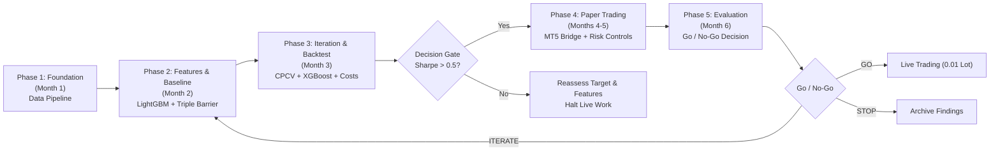

# DareFX — Development Roadmap

Six-month phased execution plan for the DareFX EUR/USD auto-trading system.

## Phase Timeline Overview

| Phase | Duration | Primary Objective | Key Deliverable | Exit Criteria |
|---|---|---|---|---|
| Phase 1: Foundation | Month 1 | Data pipeline and validation | Parquet store (2003–present) | Load 20+ years data in < 2s |
| Phase 2: Feature Engineering & Baseline Model | Month 2 | Technical features & LightGBM | Walk-forward baseline backtest | Baseline Sharpe and drawdown calculated |
| Phase 3: Model Iteration & Realistic Backtesting | Month 3 | XGBoost, CPCV, cost modeling | Multi-model evaluation report | Out-of-sample Sharpe > 1.0 (Gate: > 0.5) |
| Phase 4: Paper Trading Infrastructure | Month 4–5 | MT5 bridge, risk controls, alerts | Unattended demo trading bot | 7 days uninterrupted execution |
| Phase 5: Evaluation & Go/No-Go Decision | Month 6 | Paper trading vs backtest audit | Final performance report | Evidence-backed deployment decision |

---

## Phase 1 — Foundation (Month 1)

Goal: Understand forex mechanics. Build data pipeline. Have clean EUR/USD daily OHLCV data from 2003 to present stored in Parquet.

### Tasks
- Read `docs/FOREX-101.md` and practice with Valetax demo account manually (place 10 trades to verify order types, spreads, and pip calculations hands-on).
- Implement Dukascopy tick data downloader with HTTP retrieval, LZMA decompression, and binary parsing (`src/darefx/data/downloader.py`).
- Implement tick-to-daily OHLCV aggregation using the 17:00 New York EST close standard (`src/darefx/data/aggregator.py`).
- Implement data cleaning routines: weekend removal (Friday 17:00 EST to Sunday 17:00 EST), UTC timezone normalization, and outlier flagging (`src/darefx/data/cleaner.py`).
- Implement Parquet storage engine with annual partitioning (`src/darefx/data/storage.py`).
- Write data validation tests covering schema integrity, zero NaN values in OHLCV, positive prices, and monotonic chronological ordering (`tests/test_data.py`).
- Create exploratory data analysis notebook analyzing price trajectories, daily return distributions, rolling volatility, and autocorrelation (`notebooks/01_data_exploration.ipynb`).

### Deliverables
- `src/darefx/data/` module complete and tested.
- `data/processed/` directory populated with clean partitioned Parquet files (2003 to present).
- `notebooks/01_data_exploration.ipynb` with complete market exploratory data analysis.
- Unit and integration tests passing with 100% success rate.

### Exit Criteria
- System loads 20+ years of clean daily EUR/USD data from disk into memory in less than 2 seconds.
- Zero missing records, zero weekend bars, and valid price relations (Low <= Open, Close <= High) verified across the entire history.

---

## Phase 2 — Feature Engineering + First Model (Month 2)

Goal: Compute features, label data, train first LightGBM model, run first backtest.

### Tasks
- Implement technical indicator calculations: RSI (14), MACD (12, 26, 9), Bollinger Bands (20, 2), ATR (14), ADX (14), EMAs (20, 50, 200), Stochastic (14, 3), and OBV (`src/darefx/features/indicators.py`).
- Implement rolling z-score normalization using strictly backward-looking windows to prevent look-ahead bias (`src/darefx/features/scaler.py`).
- Implement triple barrier labeling method using ATR-scaled profit targets, stop losses, and a 5-day holding limit (`src/darefx/features/labeling.py`).
- Implement walk-forward validation split generator with expanding training windows and purge/embargo buffers (`src/darefx/models/validator.py`).
- Train baseline LightGBM multi-class classification model (`src/darefx/models/trainer.py`).
- Analyze feature importance by calculating out-of-sample SHAP values.
- Run initial vectorbt backtest accounting for a fixed 1.5-pip spread cost (`src/darefx/backtest/engine.py`).
- Create feature analysis notebook evaluating correlation structures and predictive signals (`notebooks/02_feature_analysis.ipynb`).

### Deliverables
- `src/darefx/features/` module complete and tested.
- `src/darefx/models/trainer.py` supporting LightGBM model training.
- `src/darefx/models/validator.py` executing walk-forward cross-validation.
- `src/darefx/backtest/` module with baseline execution engine.
- `notebooks/02_feature_analysis.ipynb` containing feature distributions and SHAP rankings.
- Initial backtest performance report documenting returns, Sharpe ratio, and drawdown.

### Exit Criteria
- Walk-forward backtest produces verifiable Sharpe ratio and drawdown figures on out-of-sample data.
- Feature importance ranking identifies top predictive features.

---

## Phase 3 — Model Iteration + Realistic Backtesting (Month 3)

Goal: Iterate on model. Add XGBoost. Implement CPCV. Tune hyperparameters. Get honest performance numbers.

### Tasks
- Implement Combinatorial Purged Cross-Validation (CPCV) to compute path distributions and eliminate event leakage (`src/darefx/models/cpcv.py`).
- Implement XGBoost classifier trainer (`src/darefx/models/xgboost_trainer.py`).
- Set up Optuna hyperparameter optimization pipelines for both LightGBM and XGBoost targeting out-of-sample Sharpe ratio (`src/darefx/models/tuner.py`).
- Add engineered features: multi-period raw log returns, Garman-Klass volatility regime indicators, and calendar features (day of week, month, quarter).
- Implement realistic execution cost model: variable spread (1.5 pips base), execution slippage (1.0 pip), and broker commission.
- Implement performance metrics suite: Sharpe ratio, Sortino ratio, Calmar ratio, maximum drawdown, average drawdown, win rate, profit factor, expectancy, and average trade duration (`src/darefx/backtest/metrics.py`).
- Build model comparison framework evaluating LightGBM, XGBoost, and probability ensemble models.
- Implement model registry saving versioned artifacts, schemas, and training metadata (`src/darefx/models/registry.py`).
- Create experiment tracking notebook (`notebooks/03_model_experiments.ipynb`).

### Deliverables
- `src/darefx/models/` module complete with trainers, tuners, and registry.
- `src/darefx/backtest/metrics.py` complete with all performance statistics.
- `notebooks/03_model_experiments.ipynb` comparing candidate models.
- Backtest report with realistic transaction costs and regime breakdowns.
- Model registry populated with versioned model artifacts and configuration files.

### Exit Criteria
- Best candidate model achieves Sharpe ratio > 1.0 on walk-forward out-of-sample data, or comprehensive technical documentation details failure modes and next steps.

### Decision Gate
- If no model configuration achieves out-of-sample Sharpe ratio > 0.5 under realistic transaction costs, halt development of live trading infrastructure and reassess feature definitions and label parameters.

---

## Phase 4 — Paper Trading Infrastructure (Month 4-5)

Goal: Connect to Valetax MT5 demo account. Run automated paper trading.

### Tasks
- Configure MetaTrader 5 execution environment on Linux Mint using Wine or a dedicated Windows host.
- Implement MT5 bridge for authentication, tick streaming, historical bar queries, and order submission (`src/darefx/trading/mt5_bridge.py`).
- Implement order executor applying dynamic position sizing, market orders, stop-loss, and take-profit parameters (`src/darefx/trading/executor.py`).
- Implement risk management engine with circuit breaker state machine: 5.0% daily equity loss limit and 15.0% maximum portfolio drawdown limit (`src/darefx/risk/circuit_breaker.py`).
- Implement fixed fractional position sizing (1.0%–2.0% risk) bounded by half-Kelly criteria (`src/darefx/risk/position_sizer.py`).
- Implement Telegram bot client dispatching trade executions, daily P&L summaries, and circuit breaker events (`src/darefx/notifications/telegram_bot.py`).
- Build main trading loop triggered at 17:00 New York EST daily close (`src/darefx/trading/bot.py`).
- Deploy trading loop locally as a systemd service daemon with automatic restart and file logging.
- Monitor paper trading execution on the Valetax demo account daily.

### Deliverables
- `src/darefx/trading/` module complete and operational.
- `src/darefx/risk/` module complete with active circuit breaker controls.
- `src/darefx/notifications/` module complete with automated Telegram reporting.
- Bot running live on Valetax MT5 demo account.
- Daily automated Telegram status reports.

### Exit Criteria
- Bot runs unattended for 7 consecutive business days without unhandled exceptions or service restarts.
- Telegram notification pipeline functions without failure or message delivery drops.

---

## Phase 5 — Evaluation + Go/No-Go (Month 6)

Goal: Evaluate 3+ months of paper trading. Decide whether to go live.

### Tasks
- Collect and export all MT5 paper trading trade logs, execution timestamps, fill prices, and equity histories.
- Compare paper trading empirical performance against backtest distributions.
- Run Deflated Sharpe Ratio (DSR) tests to verify whether the observed Sharpe ratio is statistically greater than zero.
- Analyze execution slippage: compare actual fill prices against the 1.0 pip assumption used in backtests.
- Analyze regime performance across bull trends, bear trends, and low-volatility consolidation ranges.
- Write evaluation report summarizing statistical findings (`docs/EVALUATION-REPORT.md`).
- Execute Go/No-Go decision framework:
  - **GO**: Deploy bot to cloud VPS, begin live capital trading with minimum lot size (0.01 lots), and maintain daily monitoring.
  - **ITERATE**: Return to Phase 2 or Phase 3 to resolve identified feature or execution discrepancies.
  - **STOP**: Terminate deployment if paper trading demonstrates no statistical edge.

### Deliverables
- Comprehensive evaluation report (`docs/EVALUATION-REPORT.md`) containing all verification metrics.
- Documented Go/No-Go decision signed off with statistical evidence.

### Exit Criteria
- Clear, evidence-based determination on proceeding to live deployment, initiating model iteration, or archiving the project.
