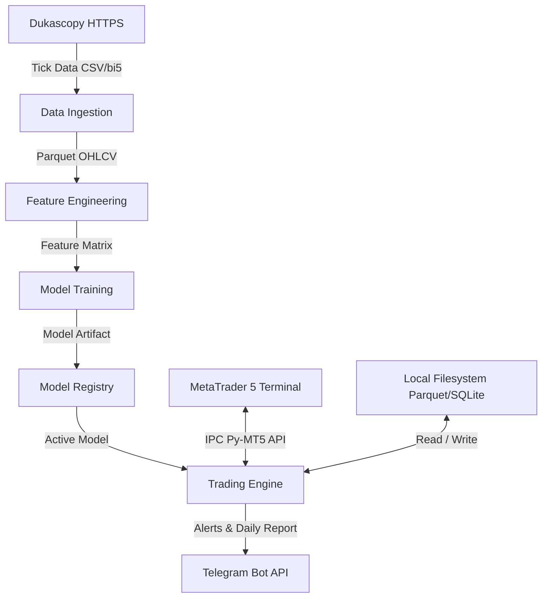

# Software Requirements Specification (SRS) — DareFX

## 1. Functional Requirements

### FR-001: Historical Tick Data Ingestion from Dukascopy
- **Description**: The system downloads raw tick data for EUR/USD from Dukascopy web endpoints, decompresses binary archives, and aggregates tick quotes into daily OHLCV bars.
- **Acceptance Criteria**:
  1. Downloads LZMA-compressed `.bi5` tick files over HTTPS for specified date ranges.
  2. Decompresses 20-byte binary structures into UTC timestamp, bid price, ask price, bid volume, and ask volume.
  3. Aligns daily bar boundaries to 22:00 UTC (17:00 New York market close).
  4. Calculates bar Open as first tick bid, High as maximum tick bid, Low as minimum tick bid, Close as last tick bid, and Volume as sum of tick volumes.
  5. Skips non-trading intervals (weekends and exchange holidays) without generating synthetic zero-volume bars.
  6. Successfully ingests 10 or more continuous years of historical EUR/USD data.

### FR-002: Recent Data Sourcing from MetaTrader 5
- **Description**: The system retrieves recent EUR/USD daily price bars directly from the MetaTrader 5 terminal to bridge the interval between historical archive updates and the current date.
- **Acceptance Criteria**:
  1. Retrieves daily rate arrays using `mt5.copy_rates_range` or `mt5.copy_rates_from_pos` for symbol `EURUSD` on `TIMEFRAME_D1`.
  2. Maps MT5 fields (`time`, `open`, `high`, `low`, `close`, `tick_volume`) to the standardized OHLCV bar schema.
  3. Merges newly fetched MT5 daily bars into the historical dataset, deduplicating bars on UTC date.
  4. Validates timestamp continuity and raises an alert if non-weekend gaps exceed 72 hours.

### FR-003: Parquet Data Storage and Partitioning
- **Description**: The system persists raw tick archives and processed daily OHLCV bars to Apache Parquet files on the local filesystem.
- **Acceptance Criteria**:
  1. Writes daily OHLCV bars to `data/processed/eurusd_d1.parquet` using the PyArrow engine.
  2. Sets UTC timestamp as the primary dataframe index.
  3. Compresses files using Snappy compression to optimize storage footprint and read speed.
  4. Validates that deserialized Parquet data matches original in-memory data types and row counts.
  5. Appends recent daily bars without requiring full dataset rewrites.

### FR-004: Technical Indicator Feature Computation
- **Description**: The system computes technical indicators on daily OHLCV bars using `pandas-ta` to generate the feature matrix used for model training and live inference.
- **Acceptance Criteria**:
  1. Computes RSI-14: Relative Strength Index with a 14-period lookback.
  2. Computes MACD-12-26-9: Fast EMA 12, Slow EMA 26, Signal EMA 9, producing MACD line, signal line, and difference histogram.
  3. Computes Bollinger Bands (20, 2): 20-period SMA middle band, upper band (+2 standard deviations), lower band (-2 standard deviations), percentage bandwidth, and percent B.
  4. Computes ATR-14: Average True Range with a 14-period lookback.
  5. Computes ADX-14: Average Directional Index with a 14-period lookback, including +DI and -DI values.
  6. Computes Exponential Moving Averages: EMA-9, EMA-21, EMA-50, and EMA-200.
  7. Computes derived normalized features: distance from Close to EMA-9, EMA-21, EMA-50, and EMA-200 (`(close - ema) / ema`), EMA-9 slope (`(ema9_t - ema9_{t-1}) / ema9_{t-1}`), and normalized volatility (`atr14 / close`).
  8. Drops the first 200 bars of historical data to eliminate warm-up NaN values caused by the 200-period EMA.
  9. Validates zero NaN or infinite values across all feature columns.

### FR-005: Triple Barrier Labeling
- **Description**: The system labels price movements using Marcos López de Prado's Triple Barrier Method, establishing dynamic profit-taking, stop-loss, and time expiration thresholds.
- **Acceptance Criteria**:
  1. Accepts configurable parameters: profit-take multiplier ($k_{pt}$, default 2.0), stop-loss multiplier ($k_{sl}$, default 1.0), and vertical holding limit in bars ($H$, default 5).
  2. Scales horizontal barriers dynamically using daily ATR-14: Upper Barrier $= Close_t + (k_{pt} \times ATR_t)$, Lower Barrier $= Close_t - (k_{sl} \times ATR_t)$.
  3. Establishes vertical barrier at bar $t + H$.
  4. Assigns discrete categorical labels based on first barrier touched:
     - Assigns `+1` (Buy) if High touches or crosses Upper Barrier first.
     - Assigns `-1` (Sell) if Low touches or crosses Lower Barrier first.
     - Assigns `0` (Neutral) if vertical barrier arrives before either horizontal barrier is touched.
  5. Resolves same-bar dual breaches by selecting the barrier nearest to that bar's Open price.
  6. Calculates sample uniqueness weights based on concurrent label lifetimes to penalize overlapping training windows.
  7. Stores features, targets, and sample weights in `data/features/labeled_dataset.parquet`.

### FR-006: LightGBM Model Training
- **Description**: The system trains a gradient-boosted decision tree classifier using LightGBM on computed features and triple barrier labels.
- **Acceptance Criteria**:
  1. Configures multiclass objective (`objective="multiclass"`, `num_class=3`) mapping labels `[-1, 0, 1]` to classes `[0, 1, 2]`.
  2. Integrates sample uniqueness weights into gradient calculation.
  3. Evaluates multiclass log-loss on validation sets with early stopping patience set to 30 iterations.
  4. Produces calibrated probability distributions across all 3 classes during inference.
  5. Serializes trained models to disk in LightGBM text/binary format (`.lgb`).

### FR-007: XGBoost Model Training
- **Description**: The system trains a gradient-boosted decision tree classifier using XGBoost as an alternative architecture to LightGBM.
- **Acceptance Criteria**:
  1. Configures tree method `hist` for histogram-based gradient boosting.
  2. Configures objective `multi:softprob` with `num_class=3`.
  3. Accepts sample uniqueness weights during training.
  4. Evaluates multiclass log-loss on validation sets with early stopping patience set to 30 iterations.
  5. Serializes trained models to disk in native JSON format (`.json`).

### FR-008: Walk-Forward Validation
- **Description**: The system performs walk-forward validation with strict purging and embargo windows to evaluate model stability over time without data leakage.
- **Acceptance Criteria**:
  1. Implements rolling and expanding window modes with configurable parameters: training length (default 1260 bars / 5 years), test length (default 126 bars / 6 months), and step size (default 63 bars / 3 months).
  2. Purges training samples whose label forward horizon overlaps with the validation test period.
  3. Applies an embargo window of 10 bars immediately following each test fold to eliminate post-test autocorrelation leakage.
  4. Generates out-of-sample prediction series concatenated across all test folds.
  5. Computes fold-level and aggregate classification metrics: log-loss, accuracy, precision, and recall.

### FR-009: Combinatorial Purged Cross-Validation (CPCV)
- **Description**: The system executes Combinatorial Purged Cross-Validation to generate combinatorial backtest paths and measure backtest overfitting risks.
- **Acceptance Criteria**:
  1. Divides the dataset into $N=6$ equal sequential blocks.
  2. Selects $k=2$ blocks for testing per fold combination, producing $\binom{6}{2} = 15$ combinations.
  3. Purges training observations whose forward label horizons intersect test blocks.
  4. Applies 10-bar embargo periods to observations following test blocks.
  5. Generates 15 distinct out-of-sample equity curves across combinations.
  6. Computes the Probability of Backtest Overfitting (PBO) across generated curves.
  7. Verifies PBO is below 0.30 before allowing model promotion to paper trading.

### FR-010: Hyperparameter Tuning with Optuna
- **Description**: The system searches model and strategy parameter spaces using Optuna's Tree-structured Parzen Estimator (TPE) algorithm.
- **Acceptance Criteria**:
  1. Defines search bounds for LightGBM/XGBoost: `learning_rate` [0.01, 0.2], `num_leaves` [15, 127], `max_depth` [3, 10], `subsample` [0.6, 1.0], `colsample_bytree` [0.6, 1.0], `reg_alpha` [1e-3, 10.0], and `reg_lambda` [1e-3, 10.0].
  2. Defines search bounds for labeling multipliers: $k_{pt}$ [1.5, 3.0], $k_{sl}$ [0.8, 2.0], and holding limit $H$ [3, 10].
  3. Directs optimization objective toward minimizing out-of-sample log-loss or maximizing out-of-sample Sharpe ratio.
  4. Records all trial evaluations, parameter values, and metrics in a local SQLite database (`data/optuna_study.db`).
  5. Terminates unpromising trials using `optuna.pruners.MedianPruner`.

### FR-011: Event-Driven Backtest Engine with Transaction Costs
- **Description**: The system executes a sequential, bar-by-bar backtest simulating realistic trade execution, transaction friction, and portfolio accounting.
- **Acceptance Criteria**:
  1. Evaluates signals generated at Close of bar $t$ and executes orders at Open of bar $t+1$.
  2. Deducts spread cost: default 1.2 pips ($0.00012$) per round turn.
  3. Deducts commission: default $7.00 per standard lot round turn ($3.50 per entry, $3.50 per exit).
  4. Deducts slippage: default 0.2 pips per order execution.
  5. Deducts overnight rollover swap fees based on long and short swap points at 22:00 UTC daily rollover.
  6. Triggers Stop Loss and Take Profit exits when bar High or Low crosses order boundaries during subsequent bars.
  7. Forces trade liquidation at Close price of bar $t + H$ if neither horizontal barrier is touched.

### FR-012: Vectorbt Portfolio Simulation
- **Description**: The system runs matrix-based strategy backtests using `vectorbt` for fast parameter sweeps and validation against the event-driven engine.
- **Acceptance Criteria**:
  1. Translates model class probabilities into boolean entry and exit signal matrices.
  2. Executes portfolio simulation using `vectorbt.Portfolio.from_signals`.
  3. Incorporates spread, commission, and slippage fees into the vectorized simulation configuration.
  4. Verifies that vectorized portfolio equity curves match event-driven backtest curves within a 2.0% maximum deviation margin.

### FR-013: Quantitative Performance Metrics Computation
- **Description**: The system computes statistical risk and return metrics from simulated or realized trade execution logs.
- **Acceptance Criteria**:
  1. Computes Annualized Sharpe Ratio: $(R_{annual} - R_f) / \sigma_{annual}$ assuming 252 trading days and $R_f = 0.0$.
  2. Computes Sortino Ratio: $(R_{annual} - R_f) / \sigma_{downside}$ utilizing negative return deviations exclusively.
  3. Computes Calmar Ratio: Annualized Return divided by Maximum Drawdown percentage.
  4. Computes Maximum Drawdown: Peak-to-trough equity decline expressed as a percentage and USD value, alongside recovery duration in trading days.
  5. Computes Win Rate: Number of closed trades with positive net profit divided by total closed trades.
  6. Computes Profit Factor: Gross profits divided by gross losses in USD.
  7. Computes Average Trade Duration: Mean holding time of closed positions expressed in trading days.
  8. Computes Expectancy: Net dollar profit divided by total closed trades.

### FR-014: Layered Position Sizing
- **Description**: The system determines position sizes using fixed fractional risk modified by half-Kelly criterion scaling.
- **Acceptance Criteria**:
  1. Sets base risk dollar budget: $Risk_{base} = Equity \times RiskPct$ where $RiskPct$ is configured to 1.0% (maximum allowable 2.0%).
  2. Calculates Kelly fraction: $f^* = \frac{p \cdot b - q}{b}$ where $p$ is predicted class confidence, $q = 1 - p$, and $b = k_{pt} / k_{sl}$.
  3. Rejects trade execution if $f^* \le 0$.
  4. Calculates half-Kelly scaling factor: $f_{half} = \max(0.1, \min(1.0, 0.5 \times f^*))$.
  5. Calculates lot size: $Lots = \frac{Risk_{base} \times f_{half}}{SL_{pips} \times PipValuePerLot}$.
  6. Enforces broker limits: minimum 0.01 lots, maximum 10.0 lots, rounded down to nearest 0.01 lot increment.

### FR-015: Circuit Breaker State Machine
- **Description**: The system manages operational risk states via an automated finite state machine that limits trading activity during severe drawdowns.
- **Acceptance Criteria**:
  1. Implements four operational states: `NORMAL`, `SOFT_PAUSE`, `HARD_HALT`, `RECOVERY`.
  2. Enters `SOFT_PAUSE` if current daily drawdown reaches or exceeds 5.0%:
     - Immediately liquidates active open trades.
     - Blocks signal execution for 24 hours.
     - Transitions back to `NORMAL` at the next daily session open if equity remains stable.
  3. Enters `HARD_HALT` if cumulative portfolio drawdown reaches or exceeds 15.0%:
     - Immediately liquidates active open trades.
     - Cancels pending orders and halts trading daemon.
     - Requires explicit operator CLI execution `darefx resume --force` to return to `NORMAL`.
  4. Enters `RECOVERY` if the system records 5 consecutive losing trades:
     - Halves base risk percentage (from 1.0% to 0.5%).
     - Returns to `NORMAL` after 2 consecutive profitable trades.
  5. Writes state machine state transitions to local persistent storage (`data/state.json`).

### FR-016: MetaTrader 5 Bridge and Order Execution
- **Description**: The system communicates with the MetaTrader 5 terminal via the Python API to execute and manage demo orders.
- **Acceptance Criteria**:
  1. Establishes connection to MT5 terminal via `mt5.initialize()`, passing path, login, server, and password credentials.
  2. Queries account equity, balance, and free margin before order dispatch.
  3. Submits market orders via `mt5.order_send` specifying `symbol="EURUSD"`, `action=TRADE_ACTION_DEAL`, `type` (`ORDER_TYPE_BUY` or `ORDER_TYPE_SELL`), `volume`, `price`, `sl`, and `tp`.
  4. Reconciles open positions returned by `mt5.positions_get` against internal trade records on every loop pass.
  5. Detects broker-side exits (Stop Loss or Take Profit fills) and writes exit records to the local trade log.

### FR-017: Telegram Notifications and Reporting
- **Description**: The system delivers operational notifications, execution alerts, and daily performance summaries to a configured Telegram chat.
- **Acceptance Criteria**:
  1. Sends instant markdown alert upon trade entry containing ticket ID, direction, volume, entry price, SL, TP, and model confidence.
  2. Sends instant markdown alert upon trade exit containing ticket ID, close reason (SL, TP, or time), exit price, pip gain/loss, and USD profit.
  3. Sends high-priority alert upon circuit breaker activation (`SOFT_PAUSE` or `HARD_HALT`) with current drawdown values.
  4. Sends daily report at 00:00 UTC summarizing account balance, equity, closed trades count, win count, and daily net profit.
  5. Generates and sends equity curve chart image via Telegram `sendPhoto` endpoint in the daily report.
  6. Implements retry logic with exponential backoff (3 attempts, max 10-second delay) on Telegram API network errors without interrupting trading execution.

### FR-018: Command-Line Interface (CLI)
- **Description**: The system provides a unified command-line interface implemented with Typer and Rich for all operational workflows.
- **Acceptance Criteria**:
  1. Implements the following CLI commands:
     - `darefx data download`: Downloads historical and recent market data.
     - `darefx data process`: Aggregates ticks to daily OHLCV and validates Parquet storage.
     - `darefx features compute`: Computes technical indicators and outputs feature Parquet file.
     - `darefx labels create`: Generates triple barrier labels and uniqueness weights.
     - `darefx model train`: Trains LightGBM or XGBoost models with walk-forward validation.
     - `darefx model tune`: Executes Optuna hyperparameter tuning.
     - `darefx backtest run`: Executes event-driven or vectorbt backtests and outputs performance metrics.
     - `darefx trade paper`: Launches the automated paper trading daemon.
     - `darefx status`: Displays current equity, active positions, circuit breaker state, and latest model metadata.
     - `darefx resume`: Resets circuit breaker state after manual review.
  2. Formats tabular outputs, operational summaries, and status indicators using Rich tables and panels.
  3. Returns standard POSIX exit status 0 on execution success and non-zero exit codes on failure.

### FR-019: Model Versioning and Artifact Registry
- **Description**: The system manages serialized model artifacts, training parameters, and performance metadata in a structured file-based registry.
- **Acceptance Criteria**:
  1. Generates a unique UUID identifier for each trained model artifact.
  2. Saves model binary, feature column list JSON, hyperparameter JSON, and evaluation metrics to `data/models/<model_id>/`.
  3. Updates registry index `data/models/registry.json` recording model ID, creation timestamp, training date bounds, out-of-sample Sharpe ratio, and validation log-loss.
  4. Sets the active production model via pointer or symlink `data/models/latest.lgb`.
  5. Prevents models failing performance thresholds (Sharpe $\le 1.0$ or Max Drawdown $\ge 20\%$) from being promoted to the active production pointer.

---

## 2. Non-Functional Requirements

### NFR-001: Execution Latency and Processing Performance
- **Requirement**: The system must complete all post-market processing within 5 minutes (300 seconds) of daily bar close (22:00 UTC).
- **Specification**: Ingestion of the latest daily bar, computation of technical indicators, feature normalization, model inference, position sizing calculation, and MT5 order transmission must execute in less than 300 seconds total elapsed time.

### NFR-002: Reliability, State Persistence, and Crash Recovery
- **Requirement**: The system must recover state deterministically following process crashes or host reboots without leaving unmonitored positions.
- **Specification**: All active orders, tickets, account equity snapshots, and circuit breaker states must persist to disk on every state transition. On daemon initialization, the system must query `mt5.positions_get()`, match broker tickets with local database records, adopt active positions into memory, and resume monitoring.

### NFR-003: Reproducibility and Deterministic Execution
- **Requirement**: Identical input data and configuration parameters must produce bitwise identical models and backtest results.
- **Specification**: The system must enforce explicit random seeds across LightGBM (`random_state=42`), XGBoost (`seed=42`), Scikit-Learn, Optuna, NumPy (`np.random.seed(42)`), and Python standard library (`random.seed(42)`).

### NFR-004: Structured Observability and Logging
- **Requirement**: The system must emit structured JSON logs to support auditability and operational troubleshooting.
- **Specification**: Every log message must include UTC timestamp (ISO 8601), log level (`DEBUG`, `INFO`, `WARNING`, `ERROR`, `CRITICAL`), calling module, and execution payload (e.g., ticket ID, signal confidence, prices, drawdown levels). Logs must write to rotating files (`logs/darefx.log`, maximum 50 MB per file, 5 backup files) and console via Rich.

### NFR-005: Security, Secrets, and Credential Management
- **Requirement**: The system must prevent unauthorized exposure of credentials, broker account passwords, and API tokens.
- **Specification**: All sensitive parameters (`MT5_LOGIN`, `MT5_PASSWORD`, `MT5_SERVER`, `TELEGRAM_BOT_TOKEN`, `TELEGRAM_CHAT_ID`) must load strictly from environment variables via Pydantic Settings. The codebase must contain zero hardcoded secrets. The `.env` file must remain gitignored, with `.env.example` defining configuration keys with dummy values.

### NFR-006: Data Integrity and Schema Validation
- **Requirement**: The system must detect and reject corrupted or anomalous market data before feature engineering and model inference.
- **Specification**: Downloaded datasets must be verified with SHA-256 checksums. Daily OHLCV data must pass validation checks: Datetime index strictly monotonic and increasing, non-null values, $High \ge \max(Open, Close)$, $Low \le \min(Open, Close)$, and $Volume \ge 0$. Any invalid bar halts pipeline processing and alerts the operator.

### NFR-007: Testability and Decoupled Architecture
- **Requirement**: Core business logic must run in automated unit and integration tests without network access or active MT5 broker terminals.
- **Specification**: Data transformations, feature calculations, triple barrier labeling, model training, position sizing, and circuit breakers must be decoupled from MT5 through interface abstraction and mock fixtures. Pytest test suite must achieve greater than 85% branch coverage across `data`, `features`, `models`, `risk`, and `backtest` packages.

---

## 3. System Interfaces



### 3.1 Dukascopy HTTPS Interface
- **Protocol**: HTTPS GET
- **Endpoints**: `https://datafeed.dukascopy.com/datafeed/EURUSD/{YEAR}/{MONTH}/{DAY}/{HOUR}h_ticks.bi5`
- **Data Format**: Binary LZMA-compressed `.bi5` structures containing 20-byte tick records (time offset, ask, bid, ask volume, bid volume).
- **Authentication**: None (public feed).

### 3.2 MetaTrader 5 Python Interface
- **Protocol**: Local Inter-Process Communication (IPC) via `MetaTrader5` Python package.
- **Core Functions**:
  - `mt5.initialize(path, login, password, server)`: Connects Python process to desktop MT5 terminal.
  - `mt5.copy_rates_range(symbol, timeframe, date_from, date_to)`: Fetches historical price bars.
  - `mt5.account_info()`: Fetches current balance, equity, and free margin.
  - `mt5.order_send(request)`: Submits market deals, Stop Loss, and Take Profit updates.
  - `mt5.positions_get(symbol)`: Queries currently open trades.
  - `mt5.shutdown()`: Closes terminal IPC connection.

### 3.3 Telegram Bot API Interface
- **Protocol**: HTTPS REST POST
- **Endpoints**:
  - `https://api.telegram.org/bot{token}/sendMessage`: Sends markdown formatted text notifications.
  - `https://api.telegram.org/bot{token}/sendPhoto`: Uploads daily equity curve PNG charts.
- **Authentication**: Secret bot token path parameter.

### 3.4 Local Filesystem Interface
- **Storage Subsystems**:
  - Raw and processed OHLCV: `data/raw/` and `data/processed/*.parquet`.
  - Feature matrices: `data/features/*.parquet`.
  - Model artifacts and metadata: `data/models/<model_id>/`.
  - Application logs: `logs/darefx.log`.
  - State database: `data/state.sqlite3`.

---

## 4. Data Schemas

```python
from datetime import datetime
from typing import Any, Literal
from pydantic import BaseModel, Field


class OHLCVBar(BaseModel):
    """Daily price bar schema for EUR/USD."""

    timestamp: datetime = Field(description="Bar close timestamp in UTC")
    open: float = Field(gt=0.0, description="Opening bid price")
    high: float = Field(gt=0.0, description="Highest bid price")
    low: float = Field(gt=0.0, description="Lowest bid price")
    close: float = Field(gt=0.0, description="Closing bid price")
    volume: float = Field(ge=0.0, description="Total tick volume")


class FeatureRow(BaseModel):
    """Calculated technical features for a single daily observation."""

    timestamp: datetime = Field(description="Bar close timestamp in UTC")
    rsi_14: float = Field(ge=0.0, le=100.0, description="14-period Relative Strength Index")
    macd_line: float = Field(description="MACD line (12 EMA - 26 EMA)")
    macd_signal: float = Field(description="MACD 9-period EMA signal line")
    macd_hist: float = Field(description="MACD difference histogram")
    bb_upper: float = Field(gt=0.0, description="Bollinger upper band (20, 2)")
    bb_middle: float = Field(gt=0.0, description="Bollinger middle SMA band (20)")
    bb_lower: float = Field(gt=0.0, description="Bollinger lower band (20, 2)")
    bb_bandwidth: float = Field(ge=0.0, description="Bollinger percentage bandwidth")
    bb_percent: float = Field(description="Bollinger percent B position")
    atr_14: float = Field(gt=0.0, description="14-period Average True Range")
    adx_14: float = Field(ge=0.0, le=100.0, description="14-period Average Directional Index")
    dmp_14: float = Field(ge=0.0, description="14-period Directional Movement (+DI)")
    dmn_14: float = Field(ge=0.0, description="14-period Directional Movement (-DI)")
    ema_9: float = Field(gt=0.0, description="9-period Exponential Moving Average")
    ema_21: float = Field(gt=0.0, description="21-period Exponential Moving Average")
    ema_50: float = Field(gt=0.0, description="50-period Exponential Moving Average")
    ema_200: float = Field(gt=0.0, description="200-period Exponential Moving Average")
    dist_ema_9: float = Field(description="Normalized distance (close - ema9) / ema9")
    dist_ema_21: float = Field(description="Normalized distance (close - ema21) / ema21")
    dist_ema_50: float = Field(description="Normalized distance (close - ema50) / ema50")
    dist_ema_200: float = Field(description="Normalized distance (close - ema200) / ema200")
    ema_9_slope: float = Field(description="Rate of change of EMA-9 over 1 bar")
    atr_norm: float = Field(gt=0.0, description="ATR-14 normalized by close price")


class TradeLog(BaseModel):
    """Execution record for an individual trade."""

    trade_id: str = Field(description="Unique trade identifier UUID")
    ticket: int = Field(default=0, description="MetaTrader 5 broker order ticket number")
    entry_time: datetime = Field(description="Order fill timestamp in UTC")
    exit_time: datetime | None = Field(default=None, description="Order close timestamp in UTC")
    direction: Literal["BUY", "SELL"] = Field(description="Order trade direction")
    entry_price: float = Field(gt=0.0, description="Executed fill price")
    exit_price: float | None = Field(default=None, gt=0.0, description="Executed closing price")
    stop_loss: float = Field(gt=0.0, description="Assigned stop loss price")
    take_profit: float = Field(gt=0.0, description="Assigned take profit price")
    pnl_pips: float | None = Field(default=None, description="Net trade result in pips")
    pnl_usd: float | None = Field(default=None, description="Net trade result in USD")
    position_size: float = Field(gt=0.0, description="Position size in standard lots")
    signal_confidence: float = Field(
        ge=0.0, le=1.0, description="Model class probability at signal generation"
    )
    exit_reason: (
        Literal["TAKE_PROFIT", "STOP_LOSS", "TIME_BARRIER", "CIRCUIT_BREAKER", "MANUAL"] | None
    ) = Field(default=None, description="Trigger mechanism for trade closure")


class ModelArtifact(BaseModel):
    """Metadata record for a serialized machine learning model."""

    model_id: str = Field(description="Unique model identifier UUID")
    model_type: Literal["lightgbm", "xgboost"] = Field(description="Algorithm architecture")
    trained_at: datetime = Field(description="Training completion timestamp in UTC")
    train_start: datetime = Field(description="Start timestamp of training dataset")
    train_end: datetime = Field(description="End timestamp of training dataset")
    test_start: datetime = Field(description="Start timestamp of out-of-sample validation")
    test_end: datetime = Field(description="End timestamp of out-of-sample validation")
    sharpe: float = Field(description="Out-of-sample annualized Sharpe ratio")
    drawdown: float = Field(description="Out-of-sample maximum drawdown percentage")
    profit_factor: float = Field(description="Out-of-sample profit factor")
    params: dict[str, Any] = Field(description="Model hyperparameters dictionary")
    sha256_hash: str = Field(description="SHA-256 hash of serialized model file")
```

---

## 5. Error Handling Strategy

| Error Scenario | Trigger Condition | Immediate Action | Circuit Breaker Impact | Recovery Procedure |
|---|---|---|---|---|
| **Broker Disconnect / IPC Failure** | `mt5.initialize()` fails or `mt5.last_error()` returns connection failure. | Log error with timestamp and error code. Retry connection 3 times with 5-second intervals. | No state change if resolved within retry window. If unresolved after 3 attempts, enter `SOFT_PAUSE`. | Restart MT5 terminal process, re-authenticate credentials, audit open positions via terminal GUI, resume loop. |
| **Data Download Failure** | HTTP 404, 502, or timeout when requesting Dukascopy `.bi5` files. | Log failed URL and HTTP status code. Back off exponentially (2s, 4s, 8s) up to 3 retries. | None (affects offline data pipeline only). | Mark date segment as missing in manifest. Resume download from next available segment; warn operator via CLI. |
| **Data Schema Corruption** | Ingested bar violates validation rules ($High < Low$, negative volume, missing timestamps). | Reject corrupted bar record immediately. Write raw corrupted payload to quarantine log. | Abort signal computation for the day; enter `SOFT_PAUSE` to prevent trading on corrupt data. | Operator reviews quarantined data, downloads clean bar from MT5 terminal history, re-runs validation checks. |
| **Model Prediction Error** | Feature vector contains NaN, feature count mismatches model schema, or inference returns non-finite probabilities. | Abort inference execution. Block order dispatch for the current bar. Send error alert to Telegram. | Enter `SOFT_PAUSE` until data and feature columns pass validation. | Validate feature engineering pipeline against current bar inputs. Recompute indicators and verify non-null values. |
| **Insufficient Margin** | `mt5.order_send` returns `TRADE_RETCODE_NO_MONEY` or free margin is below required margin. | Cancel order submission immediately. Log equity, account free margin, and requested margin. | Enter `SOFT_PAUSE`. Send critical alert to Telegram. | Re-evaluate position sizing parameters. Verify open position counts and margin allocation rules. |
| **Order Rejected / Off Quotes** | MT5 returns execution errors (`TRADE_RETCODE_REQUOTE`, `TRADE_RETCODE_PRICE_OFF`, `TRADE_RETCODE_CONNECTION`). | Log broker error code. Re-query current bid/ask quote. Retry order submission once with updated market price. | If second attempt fails, cancel order for the day. No circuit breaker state change. | Inspect broker spread and execution status. Await next daily bar close. |
| **Telegram API Failure** | Telegram API returns HTTP 429 (rate limit), 500, or network connection timeout. | Catch HTTP exception. Queue failed messages in local memory buffer. Retry delivery after backoff. | None. Trading operations continue independently of notification delivery. | Drain message queue sequentially once network connection restores. Drop duplicate charts if queue exceeds 10 items. |
| **Operating System Reboot / Crash** | System power failure or unhandled process termination. | Operating system initiates reboot. Systemd service or operator restarts `darefx trade paper`. | Retain persisted circuit breaker state from `data/state.json`. | Load persisted state; query `mt5.positions_get()`; reconcile tickets with local trade logs; resume daily monitoring. |
